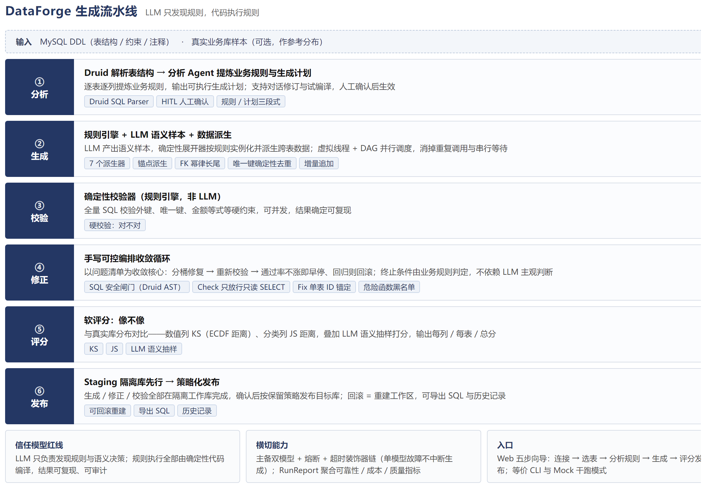

# DataForge 智能合成数据平台

> 面向开发测试与 AI 评测场景的智能仿真数据生成平台。

Faker 生成的随机数据语义失真、表间没有关联，纯 LLM 生成又容易出约束幻觉。拿这样的数据去评测 RAG、智能客服这类 AI 应用，结论本身就站不住。DataForge 把「解析数据库 DDL → 提炼业务规则 → 生成关联完整、语义真实的模拟数据 → 校验修正 → 软评分 → 落库」整条链路自动化，为 AI 评测提供可信的合成数据。

**技术栈**　Java 21 · Spring Boot 3.5 · Spring AI 1.1 · MySQL 8 · Alibaba Druid SQL Parser · DataFaker · 虚拟线程

**实测指标**　真实 LLM 调用下，全量 12527 行生成并落库 20 分 41 秒（改造前纯 LLM 逐行生成约 2.5 小时）· 数据软评分 0.365 → 0.642

## 目录

- [核心特性](#核心特性)
- [架构](#架构)
- [实测数据](#实测数据)
- [快速开始](#快速开始)
- [使用说明](#使用说明)
- [已知限制](#已知限制)

## 核心特性

- **三 Agent 协作**：分析 Agent 提炼业务规则并输出生成计划，生成 Agent 按计划规模化造数，修正 Agent 依据校验结果收敛修复。
- **信任模型红线**：LLM 只负责发现规则与语义决策，规则执行全部由确定性代码编译——结果可复现、可审计。
- **SQL 安全闸门**：基于 Druid AST 的双模式结构校验——Check 只放行只读 SELECT，Fix 限定单表 `{id}` 锚定更新并拦截危险函数，杜绝全表 UPDATE 与误删。
- **可控收敛循环**：手写编排以问题清单为收敛核心，校验 → 分桶修复 → 再校验，回归即回滚、通过率不涨即早停；终止条件由业务规则判定，不依赖 LLM 主观判断。
- **规则驱动派生**：派生列支持配置表达式与跨表聚合回填（`AGG_EQUAL` 一份规则两处复用：生成时回填、staging 修正时复核），金额与计算列不再手写 Java。详见 [docs/derive-universal-design.md](docs/derive-universal-design.md)。
- **配置驱动通用化**：换业务域只改生成计划配置，零 Java 改动（已用图书借阅库验证）。
- **增量生成**：起始 ID 取 MAX+1，外键引用现有池，修正作用域限定在新区间——现有数据永不触碰。
- **主备双模型高可用**：Failover + 熔断 + 超时装饰器链真实接入，单模型故障不中断生成流程。

## 架构



三条贯穿全流程的设计原则：

- **信任模型**：LLM 只发现规则（一次性 + 人工确认），规则执行用确定性代码——「LLM 发现、代码执行」是红线。
- **staging 先行**：生成、修正、校验都在隔离工作库完成，收敛并人工确认后按保留策略发布；回滚 = 重建工作区。
- **增量生成**：全量是增量的特例——起始 ID 取 MAX+1、引用现有池、修正作用域限定新区间。

## 实测数据

| 指标 | 结果 | 口径 |
| --- | --- | --- |
| 全量生成 + 落库（12527 行） | 20 分 41 秒 | 真实 LLM 调用，未启用 `--mock-llm`；全量重建模式 |
| 改造前基线：纯 LLM 逐行生成 | 约 2.5 小时 | V1 实现 |
| 数据软评分 | 0.365 → 0.642 | 本地自测，与真实库分布对比 |

软评分是与参考真实库的分布距离，换参考库数值会有差异，可按下方五步向导在「评分」环节复现。

## 快速开始

### 环境要求

- JDK 21、Maven 3.8+
- MySQL 8（落库、校验、评分模式需要）

### 配置凭证

复制 `.env.example` 为 `.env` 并填写。凭证一律走环境变量注入，不入仓库：

```
LLM_API_KEY=sk-xxx            # OpenAI 兼容端点 Key
LLM_BASE_URL=...              # 模型端点
LLM_MODEL=...                 # 模型名
DB_HOST=127.0.0.1             # MySQL（落库/校验/评分模式需要）
DB_PORT=3306
DB_USER=root
DB_PASSWORD=xxx
```

### 构建

```bash
mvn package
```

## 使用说明

Web 界面是唯一入口：

```bash
java -jar target/dataforge-0.1.0-SNAPSHOT.jar              # 真实 LLM（需 .env 配置 LLM_API_KEY）
java -jar target/dataforge-0.1.0-SNAPSHOT.jar --mock-llm   # 干跑模式（确定性 Mock，无需 API Key）
java -jar target/dataforge-0.1.0-SNAPSHOT.jar --server.port=8099   # 指定端口（默认 8080）
```

浏览器打开 http://localhost:8080，按五步向导操作：

1. **连接配置**：填数据库连接（主机 / 端口 / 用户 / 密码 / 库名），测试连接。
2. **选择表**：勾选要生成的表，设置每表行数（可让 LLM 推荐）。
3. **分析规则**：LLM 提炼三段规则并输出生成计划，支持对话修订与试编译。
4. **生成**：选择「全量重建 / 增量追加」，生成后自动校验修正，可预览血缘。
5. **评分 + 发布**：软评分 → 按保留策略发布目标库 → 导出 SQL → 历史记录。

## 已知限制

- 软评分需要真实库作为参考分布；没有参考库时只能看硬校验结果。
- `--mock-llm` 模式下语义抽样打分为固定值，仅用于验收链路，不代表真实数据质量。
